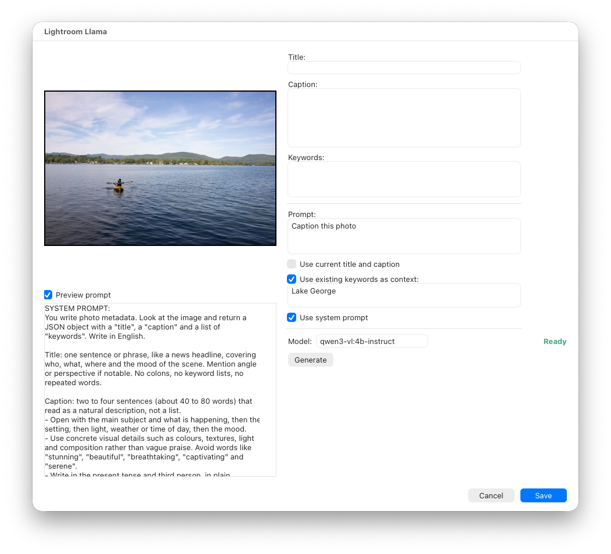

<h1 align="center">
  
   
  Lightroom Llama
</h1>

<h4 align="center">Generate titles, captions and keywords for your photos with Ollama, directly in Lightroom Classic</h4>

  <a href="#key-features">Key Features</a> •
  <a href="#how-to-use">How To Use</a> •
  <a href="#configuration">Configuration</a> •
  <a href="#troubleshooting">Troubleshooting</a> •
  <a href="#credits">Credits</a> •
  <a href="#license">License</a>

> This is a fork of [thejoltjoker/lightroom-llama](https://github.com/thejoltjoker/lightroom-llama), maintained at [pattera5/lightroom-llama](https://github.com/pattera5/lightroom-llama). It adds batch processing, keyword de-duplication, a keyword clean-up tool (LL Optimize Keywords), better error handling and a reworked prompt. See [CHANGELOG.md](CHANGELOG.md) for the full list of changes.

## Key Features

- Generate a title, caption and keywords for your photos with Ollama, directly in Lightroom Classic
- Runs entirely on your own computer: no internet required, and your photos aren't uploaded anywhere
- **Single-photo mode** to review and edit the results before saving
- **Batch mode** to caption many photos in one run, with a progress bar and cancel
- **Uses what you already know about a photo:** existing title, caption, keywords, capture date and location are given to the model as facts, so captions name the right people, places, seasons and events
- **Keeps your keyword list tidy:** merges near-duplicates such as "outdoor", "outdoors" and "outdoor setting" into your existing keywords
- **LL Optimize Keywords** merges `llm` keywords that mean the same thing (kids and children, outdoor event and event) across the whole catalog, after you review each merge, and remembers your decisions in a substitution list
- Generated keywords are filed under an `llm` parent keyword, so they are easy to find, review or remove
- Choose any Ollama vision model from the dialog, without editing code
- Prompt preview and generation timer to help you tune results

## How To Use

### Prerequisites

- Adobe Lightroom Classic
- [Ollama](https://ollama.com/) installed and running on your computer
- An Ollama **vision** model (one that can read images). The default is `qwen3-vl:4b-instruct`.

### Ollama setup

1. Open a terminal
2. Install [Homebrew](https://brew.sh/) if you don't have it already
   1. `/bin/bash -c "$(curl -fsSL https://raw.githubusercontent.com/Homebrew/install/HEAD/install.sh)"`
3. `brew install ollama`
4. Start Ollama: `ollama serve` (or open the Ollama app)
5. Download the default model: `ollama pull qwen3-vl:4b-instruct`

LL Optimize Keywords uses the same model by default. Its task is text only, so it can also use a model that can't read images.

Other vision models work too, for example `qwen3-vl:8b-instruct`, `gemma4:e4b`, `gemma4:12b` or `gemma3:12b`. Use the `-instruct` versions of Qwen models; the plain tags are "thinking" builds and are much slower.

For the latest instructions on installing and running Ollama, see [the Ollama repository](https://github.com/ollama/ollama).

### Installation

1. Clone or download the latest version from [pattera5/lightroom-llama](https://github.com/pattera5/lightroom-llama)
2. Open Adobe Lightroom Classic
3. Go to File > Plug-in Manager
4. Click the "Add" button in the bottom left
5. Navigate to the downloaded plugin folder and select the `.lrplugin` folder
6. Click "Done" to close the Plug-in Manager

To update, replace the plugin files, then select the plugin in the Plug-in Manager and click **Reload Plug-in**. If the new version adds files (2.1.0 does), restart Lightroom instead: **Reload Plug-in** only re-reads files Lightroom already knows about.

The plugin adds two menu items: **Lightroom Llama...** (in **Library > Plug-in Extras** and **File > Plug-in Extras**) and **LL Optimize Keywords...** (in **Library > Plug-in Extras**).

### Single-photo mode

Select one photo and choose **Library > Plug-in Extras > Lightroom Llama...**

1. Optionally set the options:
   - **Additional prompt text:** empty by default; anything typed here is added to the end of the request, for example "Mention the lighthouse" or "Keep the caption short". The writing guidelines themselves are always sent.
   - **Use current title and caption:** the model improves on the existing ones and keeps their names and facts
   - **Use existing keywords as context:** pre-filled with the photo's own keywords; edit the list to add hints such as a place or a person's name
   - **Use date and location:** shows when and where the photo was taken, from its metadata; greyed out if none is recorded. These are background for the title and caption: place names such as the city or state are not added as keywords (generic words such as "park" still are).
   - **Model:** any installed Ollama vision model
2. Click **Generate**. The button is greyed out until the reply arrives, then the time taken appears in blue next to the Model box. A blank title or caption in the reply leaves the current one in place. A request that times out or returns a broken reply is retried once automatically (the status shows "Retrying...").
3. Review and edit the title, caption and keywords, then click **Save**. The photo's `llm` keywords are set to exactly what is in the Keywords box: any you removed from the box are removed from the photo, and duplicate variants already on it (such as "tree" and "trees") are cut down to one. Save is greyed out while Generate is running.

Tick **Preview prompt** under the photo to see exactly what will be sent to the model.

### Batch mode

Select more than one photo and choose the same menu item.

1. Set the options and any additional prompt text (they apply to every photo, but each photo uses its own title, caption, keywords, date and location). Tick **Skip photos that already have a caption** to process only new photos.
2. Optionally enter **Keywords for this batch**, such as an event or place. These are given to the model as facts for every photo. With **Also add these keywords to every photo** ticked, they are also added to each photo as your own keywords.
3. Click **Generate for N photos**. Each photo is captioned and saved straight away, with a progress bar you can cancel.

Notes:
- Each photo is saved as its own step, so recent ones can be reverted with Edit > Undo.
- A blank result never wipes an existing title or caption.
- A photo that times out or returns a broken reply is retried once.
- A photo that hits an unexpected error is listed as failed and the batch moves on to the next one.
- If Ollama isn't running or the model is missing, the batch stops at the first photo. It also stops after 3 timeouts in a row.
- A summary at the end shows skipped photos and lists any that failed.

### How keywords are handled

- Keywords already on a photo are never repeated under `llm`.
- Place names from the photo's location, city, state and country fields are not added as keywords; they are used in the title and caption only.
- The model is asked to cover main subject or subjects, type of photo (always one, such as portrait or landscape), clothing style (one general keyword for the outfit), notable objects, setting, season and weather, time of day and light, action or pose, and mood, with 7 to 15 keywords. Anything past 15 is dropped. Your own keywords and place names don't count towards the 7 to 15, as they are removed anyway.
- For a named person the model also gives the general word (woman, man, child), and for a named place the type of place (park, lake, beach), so the photo can be found both ways.
- The model is asked to describe things, not their properties:
  - no colour on its own because one object has that colour; an object's colour is mentioned only when it stands out, joined to the object ("orange sunglasses", not "orange"), and a colour on its own is only for the main colour or tone of the whole image
  - no material, texture, size, shape or pattern of a single object ("wooden", "small", "striped"), and no body parts in an ordinary photo of a person, unless they are the subject
  - no single items of clothing or accessories ("jeans", "belt") unless the photo is about them or they stand out; one clothing style keyword ("casual clothing") instead
  - no small or distant background details, even when the caption mentions them, and no more detailed repeat of a keyword already given ("autumn colours" next to "autumn")
  - no counts ("two", "pair"), no composition words ("background", "bokeh") unless notable, and one mood word per feeling

  These are prompt rules, so a small model may occasionally ignore them.
- Near-duplicates are merged before saving, including against all your existing `llm` keywords. Matching ignores capitals, plurals (including irregular ones such as leaves/leaf and people/person) and padding words such as "setting", "scene" and "view".
- When a generated keyword matches one you already have, your existing spelling is used.
- Words such as shorts, glasses, jeans and news are treated as their own words, not plurals.
- A keyword containing commas, such as "Oslo, Norway", is split into separate keywords.
- Em dashes (and dashes used between clauses) are removed from titles and captions.

### LL Optimize Keywords

**Library > Plug-in Extras > LL Optimize Keywords...** tidies the `llm` keywords already in your catalog by merging those that mean the same thing (kids and children, outdoor event and event). It works on the whole catalog, so no photos need to be selected, and it only ever changes `llm` keywords.

A merge moves the photos from one keyword to another: photos tagged "kids" get "children" instead. The emptied keyword stays in the catalog with no photos, and its name is added as a synonym of the kept keyword, so searching for "kids" still finds the photos. Applying the substitution list and merging the reviewed groups are separate Undo steps (creating a missing To keyword is one more).

#### Start dialog

- **What to run:** apply the substitution list, then look for new keywords to merge; or apply the substitution list only.
- **Model:** the Ollama model used to find synonyms, for this run only (not saved). Any installed model works, as this is a text-only task.
- **Edit substitution list...** opens the list editor (see below).

#### Step 1: the substitution list

The substitution list is a set of From -> To rows, such as kids -> children. It is applied first, after a confirmation listing the keywords that will be replaced.

- Capitals are ignored, and chains are followed (tots -> kids and kids -> children turn tots into children).
- If the To keyword doesn't exist yet, it is created under `llm`.
- Every merge you approve in step 2 is added to the list, so the same words are replaced automatically next time. Approving the opposite merge later (children -> kids) replaces the old row.

Edit the list with **Edit substitution list...**, in the start dialog or in **File > Plug-in Manager > Lightroom Llama**. The editor has two columns, From and To:

- Type into the empty rows at the bottom. **Add rows** gives you five more (the window briefly closes and reopens, keeping what you typed; Lightroom can't add rows to an open window).
- To delete a row, clear both boxes.
- Nothing is saved until you click **Save**. Rows with only one side filled in are pointed out before saving.

#### Step 2: finding new matches

Every `llm` keyword that is on at least one photo is compared in four ways:

| Method | Finds | Starts |
|---|---|---|
| Same word | Keywords that are equal ignoring capitals, plurals and filler words (tree/trees, forest/forest scene) | Ticked |
| Synonym list | Pairs in the plugin's built-in list (kids/children, bike/bicycle, colour/color) | Ticked |
| Longer form | A keyword that is another keyword plus one extra word at the start or end (outdoor event/event, pushing motion/pushing, wooden fence/fence) | Ticked when the extra word is a padding word (outdoor, wooden, metal, motion...); otherwise unticked (smiling woman/woman) |
| Ollama | Synonyms suggested by the model (forest/woods, life vest/life jacket, noon/midday) | Ticked; unticked if the model's suggestions form a group of more than 4 keywords, or if a pair couldn't be checked |

About the Ollama step:

- The model is sent the list of keywords and asked for replacement pairs. It is told not to pair different people, objects, actions or feelings, and to leave longer forms to the check above.
- Each pair it suggests is then **checked with a separate yes/no question** ("do these two keywords mean the same thing?"). A small model answers one pair far more reliably than it writes the list: in testing, this rejected every wrong pair (black t-shirt/black shorts, tree/hedge, barn/house) and took 43 seconds for 132 pairs. It is a little strict, so a few real synonyms may be rejected; add those to the substitution list.
- If the model's reply is cut off (small models sometimes repeat themselves until they run out of room), the pairs it completed are still used.
- If Ollama can't be reached, the other three methods are still used and the dialog says so.
- A keyword that could be read as a longer form two ways (casual clothing: casual or clothing) is not offered.

#### Review and merge

A dialog lists each group with photo counts, how it was found, a tick box and a **Keep** menu:

- Groups that start unticked say "Not ticked: check before merging". **Tick all** and **Untick all** are at the top.
- The keyword to keep is chosen in this order: a spelling you already use outside `llm`; a shorter form contained in another keyword of the group (obstacle course rather than outdoor obstacle course); the keyword on the most photos. When two are still tied, the menu says "Choose one..." and the group is only merged once you pick.
- Click **Merge** to merge the ticked groups.

The log lists everything the run did: the keywords sent to the model (with photo counts), the model's reply, each rejected pair, each oversized group and each merge.

To remove the emptied keywords afterwards, choose **Metadata > Purge Unused Keywords**. The synonyms stored on the kept keywords are not affected.

## Configuration

Settings at the top of `LrLlama.lua`:

| Setting | Default | Purpose |
|---|---|---|
| `model` | `qwen3-vl:4b-instruct` | Default model shown in the dialog |
| `thumbnailSize` | `768` | Longest side in pixels of the image sent to the model. Larger shows more detail but is slower. |
| `requestTimeout` | `180` | Seconds to wait for Ollama to answer one photo |
| `maxKeywords` | `15` | Most keywords kept from each reply |
| `maxReplyTokens` | `600` | Most tokens a reply may use, so a model stuck repeating itself stops quickly |
| `offerVocabularyToModel` | `false` | List your existing `llm` keywords in the prompt. Small models tend to copy unrelated keywords from it, so leave off unless using a larger model. |

Requests also keep the model loaded for 30 minutes, use a temperature of 0.3 and a mild repetition penalty (1.1), fix the context size at 8,192 tokens and switch off "thinking".

Settings at the top of `LrOptimizeKeywords.lua` (LL Optimize Keywords):

| Setting | Default | Purpose |
|---|---|---|
| `model` | `qwen3-vl:4b-instruct` | Default model asked which keywords are synonyms; can be changed in the start dialog |
| `requestTimeout` | `180` | Seconds to wait for Ollama's answer |
| `maxKeywordsForOllama` | `1500` | Most keywords sent to the model (most-used first), to fit its context size |
| `maxOllamaGroupSize` | `4` | Largest group the model's suggestions may form before it starts unticked |
| `checkOllamaPairs` | `true` | Check each pair Ollama suggests with a separate yes/no question before offering it |
| `paddingWords` | outdoor, wooden, motion... | Extra words that make a longer form start ticked (outdoor event -> event) |
| `synonymGroups` | short list | Words that always count as the same (kids/children, bike/bicycle) |

The substitution list is kept in Lightroom's plug-in preferences and edited with **Edit substitution list...**, not in a file.

## Troubleshooting

**Logs** are written to:
- macOS: `~/Library/Logs/Adobe/Lightroom/LrClassicLogs/LrLlama.log`
- Windows: `%LOCALAPPDATA%\Adobe\Lightroom\Logs\LrClassicLogs\LrLlama.log`

Watch it live on macOS with `tail -f ~/Library/Logs/Adobe/Lightroom/LrClassicLogs/LrLlama.log`.

| Message | Cause and fix |
|---|---|
| Could not reach Ollama | Ollama isn't running. Start it with `ollama serve` or the Ollama app. |
| Ollama took longer than 180 seconds to answer | Ollama is running but slow or stuck. Retried once automatically; if it persists, restart Ollama. |
| Ollama error: model '...' not found | The model isn't downloaded. Run `ollama pull <model>` or pick an installed model from `ollama list`. |
| Ollama error: structured output is unavailable | Handled automatically: the plugin retries without JSON mode. Avoid `:cloud` and `-mlx` tags if problems continue. |
| The model's reply wasn't valid JSON / was cut off | The model broke format or got stuck repeating itself. Retried once automatically; the full reply is in the log. |
| Ollama returned an empty response / spent its whole reply thinking | The model's "thinking" used up the reply. Use a non-thinking model, such as an `-instruct` build. |
| Could not save to the photo | Lightroom was busy (for example another plugin or a sync was writing to the catalog). Click Save again in a moment. |
| No script by the name ... (in the plug-in error log) | A new version added files that Lightroom hasn't seen yet. **Reload Plug-in** doesn't pick up new files: restart Lightroom, or remove the plugin in the Plug-in Manager and add it again. |
| LL Optimize Keywords: Ollama was not used | Ollama couldn't be reached or gave no usable answer. The same-word, synonym-list and longer-form matches are still shown; the reason is in the dialog and the log. |
| LL Optimize Keywords: the model's reply was cut off | The model ran out of room, usually by repeating itself. The pairs it completed are still used. |

**Place names missing:** the plugin reads Lightroom's location, city, state and country fields, not raw GPS. Fill those fields from the Map module first.

**Performance:** Ollama's reply in the log includes timings (`prompt_eval_duration` for reading the image and prompt, `eval_duration` for writing the reply, in nanoseconds). Building standard-sized previews in Lightroom before a large batch also helps.

## TODO

- [x] Add support for more LLM models
- [x] Implement batch processing for multiple photos
- [x] Improve error handling and user feedback
- [ ] Add customizable prompt templates
- [ ] Create settings panel for model configuration
- [x] Clean up temporary thumbnail files
- [x] Merge true synonyms (for example "woods" and "forest")
- [x] Tool to merge duplicate `llm` keywords already in the catalog (LL Optimize Keywords)
- [ ] Put processed batch photos in a review collection
- [ ] Stop merged keywords coming back: Lightroom Llama doesn't yet apply the substitution list when it generates keywords, so a merged keyword ("kids", merged into "children") can be added to new photos again. It also reuses the emptied keyword, as it still exists in the catalog with no photos. To do after the substitution logic is refined.
- [ ] Open the single-photo dialog faster: it currently asks Lightroom for the photos on every `llm` keyword (about 400 calls) just to sort existing spellings by use
- [ ] Let the substitution list hold keywords containing `;` or `->` (at the moment these characters act as separators when the list is saved)
- [ ] At generation, save a keyword as the `llm` keyword it is a synonym of (merges record "kids" as a synonym of "children"), and ignore `llm` keywords with no photos when matching
- [ ] LL Optimize Keywords: remember groups left unticked ("keep apart" list) so they aren't offered again on every run
- [ ] LL Optimize Keywords: skip asking the model when the keyword list hasn't changed since the last run
- [ ] LL Optimize Keywords: don't check pairs the code already linked (same word, synonym list)
- [ ] LL Optimize Keywords: check each pair in both orders and keep it if either answer is yes (finds more real synonyms, about twice the checking time)
- [ ] LL Optimize Keywords: try a larger model (such as gemma3:12b) for finding synonyms
- [ ] LL Optimize Keywords: edit the built-in synonym list and padding words in the Plug-in Manager (perhaps as starting entries of the substitution list)
- [ ] LL Optimize Keywords: sort the review dialog, ticked groups first, then by photo count
- [ ] Decide whether single-photo Save should keep an `llm` keyword that has the same name as one of your own keywords on the photo (at the moment the `llm` copy is removed)

## Credits

- **Original plugin:** [thejoltjoker/lightroom-llama](https://github.com/thejoltjoker/lightroom-llama) by Johannes ([thejoltjoker](https://github.com/thejoltjoker))
- **Fork and enhancements:** [pattera5](https://github.com/pattera5), developed with the assistance of [Claude](https://claude.ai) by Anthropic
- **JSON encoder/decoder (`JSON.lua`):** Jeffrey Friedl ([regex.info](http://regex.info/blog/))
- [Ollama](https://ollama.com/)

## More from the original author

- [Lightroom Power Collection](https://github.com/thejoltjoker/lightroom-power-collection) - Lightroom plugin to create a smart collection to semi-automate publishing.
- [Lightroom Workflow](https://github.com/thejoltjoker/lightroom-workflow) - Lightroom workflow and presets for editing, organizing and exporting photos.
- [ChatGPT for Maya](https://github.com/thejoltjoker/chatgpt-for-maya) - Autodesk Maya plugin for context aware chatting with ChatGPT.

## License

This project is licensed under the [MIT License](LICENSE), the same license as the original project.

- Copyright (c) 2024 Johannes (original plugin)
- Copyright (c) 2026 pattera5 (fork and enhancements)
